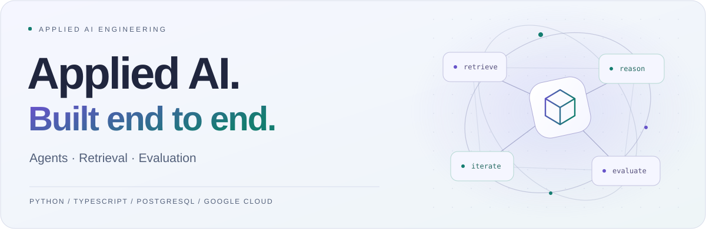

<picture>
  <source media="(prefers-color-scheme: dark)" srcset="assets/hero-dark.svg">
  <source media="(prefers-color-scheme: light)" srcset="assets/hero-light.svg">
  
</picture>

  <a href="https://www.linkedin.com/in/hectorjimenezpalomo/">LinkedIn</a>
  &nbsp; / &nbsp;
  <a href="https://github.com/hector2394/StudyAgent">StudyAgent</a>
  &nbsp; / &nbsp;
  <a href="https://github.com/pulls?q=is%3Apr+author%3Ahector2394+is%3Amerged+-user%3Ahector2394">Merged contributions</a>

I build AI applications and the backend systems around them. **AI Engineer Intern
at Astrafy**, final-year Computer Engineering student, based in Madrid.

## Selected work

<table>
  <tr>
    <td width="50%" valign="top">
      <h3><a href="https://github.com/hector2394/StudyAgent">StudyAgent</a></h3>
      
A self-hosted RAG assistant for private documents. Ask questions with source metadata, generate quizzes and flashcards, and return to saved conversations.

      
Asynchronous ingestion, pgvector retrieval, five validated tools, user-scoped access controls and a local MCP server.

      
TypeScript · Python · PostgreSQL · pgvector

      <a href="https://github.com/hector2394/StudyAgent/blob/main/ARCHITECTURE.md">Architecture</a> · <a href="https://github.com/hector2394/StudyAgent/blob/main/docs/setup.md">Setup</a>
    </td>
    <td width="50%" valign="top">
      <h3>Layeh's Market</h3>
      
An independent software project for an ARK gaming community. I develop and maintain its Python automation and TypeScript web application.

      
Ticketing, community operations, authentication, order management and payment integrations.

      
Python · TypeScript · Next.js · PostgreSQL

      <a href="https://www.linkedin.com/in/hectorjimenezpalomo/">Project background</a>
    </td>
  </tr>
</table>

StudyAgent includes TypeScript/Python evaluation harnesses. A public evaluation corpus and measured quality baseline are still planned. <a href="https://github.com/hector2394/StudyAgent/blob/main/evals/README.md">Explore the evaluation tooling.</a>

## Open source

Selected fixes and features merged upstream.

| Project | Contribution |
| :--- | :--- |
| **SQLFluff** | [Parse concatenation in simple CASE expressions](https://github.com/sqlfluff/sqlfluff/pull/9020) |
| **SQLFluff** | [Add dbt JSON helpers to the Jinja templater](https://github.com/sqlfluff/sqlfluff/pull/8853) |
| **eslint-plugin-regexp** | [Name flat configurations in ESLint's config inspector](https://github.com/ota-meshi/eslint-plugin-regexp/pull/1073) |
| **wii-tv** | [Fix paused frame scheduling and reduce clock reads](https://github.com/MauroProto/wii-tv/pull/3) |

## Toolkit

  <kbd>Python</kbd> &nbsp; <kbd>TypeScript</kbd> &nbsp; <kbd>PostgreSQL</kbd> &nbsp; <kbd>Google Cloud</kbd> &nbsp; <kbd>Terraform</kbd>

Agent tools · RAG · Evaluation · Google ADK · MCP · CI/CD
